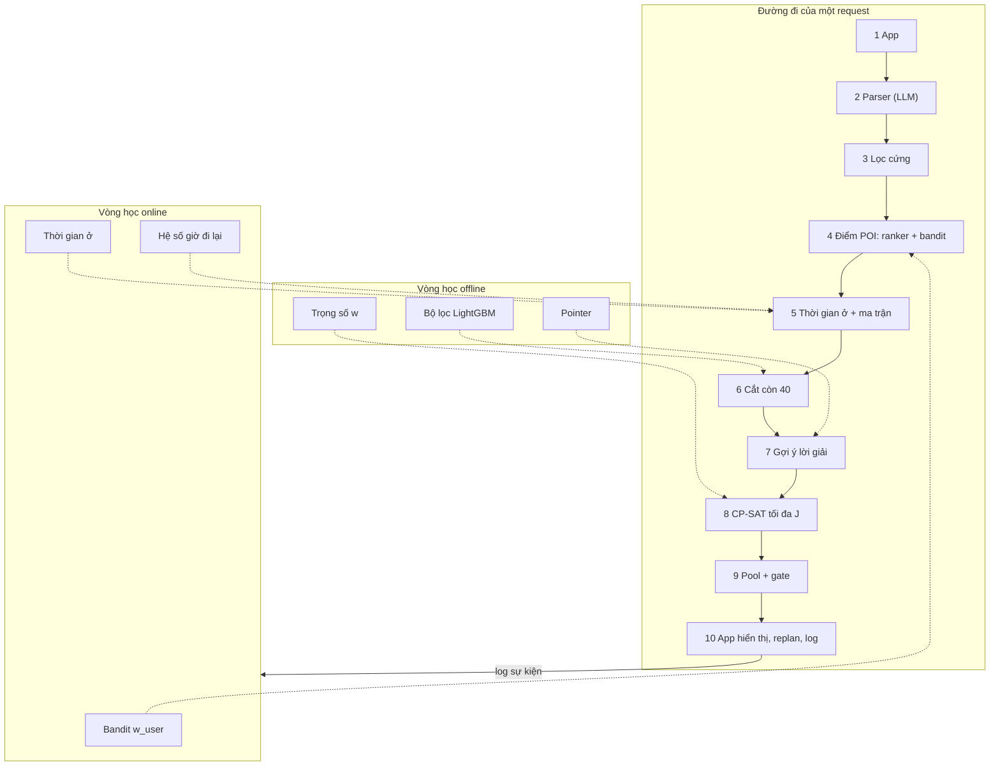

# Davel — Kiến trúc mới (toàn luồng)

Cập nhật 25/11/2026. Bản này đồng bộ với doc "Davel — Kiến trúc mới (toàn luồng)" trên claude.ai. Hàm mục tiêu chi tiết: `OBJECTIVE_V1.md`. Bối cảnh và quyết định cũ: `TRAVELAGENT_CONTEXT.md`, `ARCHITECTURE_BACKLOG.md`.

Hệ thống gồm **một đường đi của request (10 bước)** và **hai vòng học**: vòng offline học trọng số hàm mục tiêu, bộ lọc và pointer; vòng online cập nhật sở thích, thời gian ở và thời gian đi từ log của user. Model tự train chỉ nằm ở bước 4–7 và trong trọng số của bước 8; còn lại là luật, solver hoặc LLM có sẵn.



## 1. Luồng một request

| # | Thành phần | Đầu vào → đầu ra | Mục đích | Loại | Trạng thái 25/11 |
|---|---|---|---|---|---|
| 1 | App (Flutter) | câu nói + onboarding (pace, food_prefs, outdoor_bias, spending, nơi ở, khu vực) → text + profile | thu yêu cầu | giao diện | có; profile và điểm xuất phát đã truyền đúng (PR #29, #35) |
| 2 | `parser.py` | câu tiếng Việt → trip JSON (hard / soft / assumptions / uncertainties); thiếu thì hỏi | tách điều bắt buộc khỏi điều thích | LLM có sẵn | có |
| 3 | `retrieval.py` | trip + POI danang-v2 → khoảng 590 ứng viên (trung vị) + nhóm hoạt động | bỏ điểm không thể đi: sai khu vực, đóng cửa, avoid, chưa xác minh | luật cứng | có; lọc theo khu vực (PR #30, #35), món ăn là wish (PR #31) |
| 4 | `rank.py` + bandit | ứng viên, profile, thời tiết, w_user → điểm v_i | gu chung + gu riêng | luật + model online | ranker có; bandit chưa |
| 5 | thời gian ở + `matrix.py`, `travel_time.py` | POI, giờ → d_i (p50, p75); ma trận OSRM → m_ij | thời lượng sát thực tế; tính cả chặng từ nơi ở | model online + ma trận | prior 31 loại; hệ số giờ chỉ để kiểm (A4) |
| 6 | `_cap_candidates` (sau này bộ lọc học) | 590 → 40 ứng viên + sàn: must_visit, hoạt động đã nêu, quán ăn, cafe | thu nhỏ bài toán | luật → model offline | top-40 ở v1; LightGBM khi thắng top-40 |
| 7 | gợi ý lời giải | 40 ứng viên → thứ tự gợi ý (`AddHint`) | CP-SAT tìm lời giải nhanh hơn | greedy → model offline | greedy hint (bỏ điểm trùng); pointer để sau |
| 8 | `optimizer.py`, `profiles.py` | ứng viên, d_i, m_ij, ràng buộc, trọng số w → lịch | chọn và xếp điểm tối đa J | solver | **v1 mặc định** từ 25/11 (`DAVEL_OBJECTIVE=legacy` để so); ngân sách × 1,6 |
| 9 | `pool.py`, `gate.py` | 3 lịch (3 bộ trọng số theo profile) → lịch đã kiểm | gate chốt bữa trưa và luật cứng; luật gu chỉ ghi số liệu | luật | có |
| 10 | `response.py` + app | lịch → hiển thị, chạy chuyến, replan, ghi log | | giao diện | thiếu log giờ đến/rời, lý do bỏ, đánh giá |

Chuyến 2 ngày: `multiday.py` chạy bước 6–9 cho từng ngày theo thứ tự, chia ngân sách và must_visit giữa các ngày. LLM shadow ranker (`ranker.py`) không nằm trên đường request; nó được dùng lại để chấm cặp lịch trong vòng offline.

## 2. Các model

Sáu model tự train (3 offline, 3 online) và 2 LLM dùng sẵn. Trọng số hàm mục tiêu và bandit là cùng một model ở hai cấp: chung cho mọi người, và riêng từng user.

| Model | Loại | Học từ | Khi nào | Đầu vào → đầu ra | Đánh giá | Trạng thái |
|---|---|---|---|---|---|---|
| Trọng số hàm mục tiêu | logistic theo cặp + perceptron, các hệ số tổng của J | cặp lịch LLM chấm, lịch mẫu công bố, cặp người chấm | offline, khi có nhãn mới | hiệu đặc trưng của hai lịch (`objective.features`) → w | test tự động; khớp cặp người giữ riêng | v1 đặt tay, mặc định; chưa học |
| Bộ lọc ứng viên | LightGBM phân loại | lời giải CP-SAT thầy | offline | đặc trưng mỗi ứng viên → xác suất được chọn | recall@40, điểm lịch so với thầy, thời gian | bản thử recall@40 0,964 (chưa vào nhánh); train lại sau khi chốt w |
| Pointer | Transformer + pointer attention | thứ tự ghé của thầy | offline | trip + 40 ứng viên → thứ tự ghé | top-1 / top-3; tốc độ so với greedy hint | chưa |
| Bandit sở thích | Bayesian logistic + Thompson | sửa / chọn / bỏ lịch, đánh giá | online | cặp lịch của user → w_user | regret trên user giả lập; pilot | chưa |
| Thời gian ở | Bayes log-normal theo POI | check-in / check-out | online | lượt ở thật → p50, p75 | sai số trên 45 POI đã xác nhận | prior có |
| Hệ số giờ đi lại | Bayes theo cặp zone × khung giờ | thời gian đi thật | online | log chặng → hệ số nhân vào ma trận | sai số giờ đến | prior thiết kế |
| Parser | LLM dùng sẵn | — | — | câu nói → trip JSON | đúng trường trên 30 câu gold | có |
| LLM judge | Claude trong phiên (chốt 25/11) | — | offline | cặp lịch → A / B / hòa, hỏi hai chiều | tỉ lệ tự mâu thuẫn | sẵn giao thức trong `ranker.py` |

PATM (LightGBM trên 1.770 cặp chuyển tiếp) vẫn chạy, là số hạng T10. Giữ hay bỏ do ablation quyết.

## 3. Hàm mục tiêu và sổ luật

CP-SAT chọn lịch có J lớn nhất trong các lịch thỏa mọi ràng buộc cứng.

```
J = Σ v_i x_i + w_state·S − T3 lặp nhóm − T4 liền kề cùng nhóm + T5 bữa đúng giờ
    − T6 bữa dồn + T7 nghỉ trưa − T8 vượt nhịp − T9 chạy xe/đổi vùng + T10 PATM
    − T11 điểm trùng
```

| Lớp | Gồm | Trong CP-SAT | Gate |
|---|---|---|---|
| Vật lý | giờ mở cửa, đi kịp theo ma trận, không chồng giờ, POI đã xác minh, tối đa 1 suất đặt chỗ | ràng buộc | trượt thì loại lịch |
| User nói | must_visit, avoid, ngân sách, giờ về, hoạt động đã nêu, must_avoid, đi lại, bữa trưa (LUNCH), `strict_rules` | ràng buộc | trượt thì loại lịch |
| Gu | đa dạng (T3, T4), bữa ăn (T5, T6), nghỉ trưa (T7), nhịp (T8), chạy xe và đổi vùng (T9), điểm trùng (T11) | số hạng trong J | chỉ ghi số liệu |

**Mỗi luật chỉ ở một chỗ.** `BE/app/services/rules.py` là sổ luật duy nhất; gate, `soft_rules`, `objective`, `scorer` đọc từ đó:

| Lớp | Luật | Ở đâu |
|---|---|---|
| physical | FAR, VROH, B3 | ràng buộc CP-SAT + gate cứng |
| user | PROFILE_SAFE, BCS, ETB, LUNCH, must_visit / avoid | ràng buộc CP-SAT + gate cứng (LUNCH nằm trong HCS) |
| taste | A1, CAFE_CAP, CATEGORY_CAP, NO_CONSECUTIVE, NO_ADJACENT_FOOD, REST_FOLLOWS_LUNCH; SAME_SITE, MARKET_REPEAT, SAME_DISH | v1: số hạng T3–T7 và T11, gate chỉ báo cáo (T11 không có check gate riêng để khoá `constraint_status` không đổi; báo cáo eval tự đếm); cứng lại khi có trong `strict_rules` |
| quality | F1, TIME_FIT, DINNER | chỉ báo cáo |
| edge | A2, B1, B2, E2 | legacy: phạt trên cạnh q_ij; v1: T6, T4, T3, T2 lo, cạnh chỉ còn điểm PATM |

Thay đổi so với legacy: bắt buộc bữa tối, A1, giới hạn cafe, nghỉ trưa, late_end, pace min/max và nhóm bắt buộc của template chuyển thành số hạng. T9 gom phút chạy xe (legacy đã trừ nhẹ trên cạnh, `EDGE_TRAVEL_WEIGHT`), phần chặng dài và đổi vùng về một chỗ. User vẫn giữ quyền: nói rõ "mỗi loại một điểm" thì luật vào `strict_rules` và thành cứng.

## 4. Vòng học offline

Vòng offline tạo ba file mà đường request đọc: trọng số w, model bộ lọc, model pointer. **Thứ tự bắt buộc: chốt w trước**, vì bộ lọc và pointer học theo lời giải của CP-SAT chạy dưới w đó.

1. **Chốt hàm mục tiêu** — xong: v1 + bước 1 (T11, bữa tối, nhịp, ngân sách), PR #38.
2. **Học trọng số w** (`OBJECTIVE_V1.md` §7):
    - sinh cặp lịch bằng hai vector w lệch nhau, cộng 459 cặp có sẵn;
    - Claude trong phiên chấm mỗi cặp hai chiều theo giao thức của `ranker.py`, bỏ cặp tự mâu thuẫn;
    - thu 30–50 lịch mẫu đã công bố, học bằng perceptron;
    - chọn bộ w thắng trên test tự động, ghi ra file mới cùng khoá với `v1.json`.
3. **Sinh data thầy** (`gen_teacher_data.py`): 40% biến thể của 30 câu gold, 60% ngẫu nhiên theo 8 khung giờ, ngân sách 0,5–5 triệu, 1–6 người. Thầy mạnh hơn production: cap 40 và ngân sách CP-SAT lớn hơn (ở v2, 82% bài dừng vì hết giờ). 10.000–20.000 bài, khoảng 300 bài mỗi luồng mỗi giờ.
4. **Train bộ lọc** (`BE/ml/filter/train.py`, chia train/test 80/20 theo request) và **pointer** (mỗi bước đoán điểm kế tiếp; chạy thử trên 1.841 bài v2 trước để bắt lỗi pipeline).
5. **Verify rồi bật qua cờ:** gate 100%, recall, tốc độ, test tự động. Cờ: `DAVEL_OBJECTIVE`, `DAVEL_LEARNED_FILTER`, cờ pointer mới.
6. **Lặp lại khi cần.** Đổi w → sinh lại data thầy và train lại bộ lọc, pointer. Đổi data (POI mới, giờ mở / giá mới, ma trận mới) → chạy lại eval; nếu lời giải đổi nhiều thì sinh lại data thầy và train lại; trọng số chỉ học lại khi chỉ số tụt hoặc có nhãn mới. Code giữ nguyên.

| File tạo ra | Dùng ở bước | Chọn qua |
|---|---|---|
| `objective_weights/vN.json` | 8 (CP-SAT) | `DAVEL_OBJECTIVE` |
| `models/filter_vN/` (model.txt, meta.json) | 6 (bộ lọc) | `DAVEL_LEARNED_FILTER` |
| `models/pointer_vN/` | 7 (pointer) | cờ pointer mới |

Data và model sinh ra để ở `davel_distill_data/`, không để trong repo.

## 5. Vòng học online

Ngày đầu ba model online chỉ dùng prior, nên hệ thống chạy như bản offline; chúng học khi app ghi được các sự kiện dưới đây. Hiện repo mới có `acceptance_store.py` lưu lịch được chấp nhận.

| Sự kiện trong app | Ghi gì | Model |
|---|---|---|
| Hiện 1–3 lịch từ pool | lịch nào được hiện, propensity | bandit (đánh giá không thiên lệch) |
| User chọn 1 lịch | cặp: lịch chọn tốt hơn lịch bỏ | bandit |
| User xóa, đổi, thêm điểm | cặp: lịch sau sửa tốt hơn lịch trước | bandit |
| Check-in / check-out (GPS hoặc nút) | thời gian ở thật | thời gian ở |
| Đến điểm kế tiếp | thời gian đi thật | hệ số giờ đi lại |
| Bỏ qua điểm trong chuyến | tín hiệu yếu: không thích hoặc trễ giờ | bandit; kích hoạt replan |
| Đánh giá sau chuyến (1–5 sao mỗi điểm) | điểm hài lòng | bandit |

- **Bandit sở thích:** cùng dạng với model trọng số, mỗi user một w_u bắt đầu từ w chung, cập nhật Bayes sau mỗi cặp; khi xếp lịch lấy mẫu từ phân phối của w_u (Thompson sampling).
- **Thời gian ở:** prior tính như n₀ lần quan sát ảo theo độ tin của nguồn. Ví dụ biển Mỹ Khê: bảng 90 phút, sau 4 lượt thật 120, 150, 100, 130 phút với n₀ = 4, ước lượng mới khoảng 105 phút.
- **Hệ số giờ đi lại:** cập nhật cùng cách theo cặp vùng × khung giờ, bắt đầu từ `BE/data/priors/travel_time_factors.json`.

Thêm bảng sự kiện đụng API và migration DB, nên cần duyệt thiết kế trước khi làm.

## 6. Replan trong chuyến

| Chi tiết | |
|---|---|
| Khi nào chạy | user trễ giờ, bỏ điểm, đổi ý, thời tiết đổi, điểm báo đóng cửa |
| Đầu vào | trạng thái chuyến (điểm đã đi, điểm còn lại), sự kiện, vị trí và giờ hiện tại |
| Xử lý | CP-SAT giải lại phần còn lại với cùng hàm mục tiêu và cùng khoá của stub (nhóm, zone, T11); hạn cuối = min(giờ kết thúc, giờ phải về) (`replan.py`, `state.py`; PR #36) |
| Đầu ra | lịch phiên bản mới; hoặc hỏi lại khi sự kiện xung đột ràng buộc cứng; hoặc báo không có lời giải, vẫn giữ phần đã đi |
| Model tham gia | thời gian ở, hệ số giờ đi lại, w_user; lịch cũ làm hint thay cho pointer |
| Sinh ra log | mỗi lần replan là một sự kiện cho vòng online |

Đề xuất thêm (chưa có): số hạng "ổn định" phạt mỗi điểm còn lại bị đổi so với lịch cũ, để replan chỉ sửa chỗ cần sửa.

## 7. Data

| Data | Quy mô | Nguồn | Dùng cho | Trạng thái 25/11 |
|---|---|---|---|---|
| POI danang-v2 | 1.029 POI: 916 active (840 điểm dừng + 76 nơi ở), 93 excluded, 20 review | crawl, OSM, người xác minh; trường Google bị cách ly | mọi bước | mặc định (PR #32); nhãn món `tags.dishes` (PR #31); nhãn cùng chỗ / gộp bản ghi (PR #38) |
| Ma trận đi lại | 1.009 × 1.009, phút và km | OSRM xe máy | ràng buộc đi kịp, T9 | có, gồm nơi ở; 20 quán mới chờ dựng lại |
| Prior thời gian ở | 31 loại; 45 POI đã xác nhận | `v2_rules.py` | model thời gian ở | có; phần lớn độ tin 0,4 |
| Prior hệ số giờ | zone × khung giờ | `travel_time_factors.json` | hệ số giờ đi lại | có, chưa hiệu chỉnh |
| Câu gold | 30 câu | `BE/eval/gold/gold_v2.json` | kiểm parser, đo trước/sau | có |
| Data thầy | v1: 2.124 bài; v2: 1.841 bài | `gen_teacher_data.py` | bộ lọc, pointer | có; phải sinh lại sau khi chốt w |
| Cặp lịch | 459 cặp | `eval_learned40.jsonl`, `compare_v1_vs_v2.jsonl` | học w | có, chưa chấm |
| Cặp người chấm PATM | 150 cặp (108 có lựa chọn) | người chấm | PATM | so 2 POI, không dùng thẳng cho w |
| Lịch mẫu đã công bố | cần 30–50 lịch | trang du lịch, blog (giữ link) | học w | chưa thu |
| Log user | — | app | 3 model online | chưa có; chỉ có lịch được chấp nhận |

Giới hạn: không dùng trường Google để train hay chạy production khi chính sách chưa cho phép; không dùng API trả phí; không bịa data (thiếu thì ghi KHÔNG XÁC ĐỊNH).

**Trạng thái data theo từng bước.** Phần thu tay do Bách làm; thứ tự ưu tiên: giờ mở và giá của POI hay vào lịch (100 POI = 96% lượt xuất hiện trong 1.703 lịch), rồi lịch mẫu, bộ câu kiểm parser.

| Bước | Đã có | Ước lượng / yếu | Còn thiếu | Máy tự sinh |
|---|---|---|---|---|
| 1 App | profile, điểm xuất phát, khu vực | — | — | — |
| 2 Parser | LLM | — | bộ câu kiểm parser | — |
| 3 Lọc cứng | POI danang-v2 | giờ mở: 342 có nguồn, 498 ước lượng; giá ~11% có nguồn | — | — |
| 4 Điểm POI | nhãn POI; nhãn món (PR #31) | độ nổi tiếng 33 mức | w_user (cần log) | — |
| 5 Thời gian | ma trận 1.009 × 1.009 | bảng thời gian ở 31 loại; hệ số giờ | hàng ma trận cho 20 quán mới | — |
| 6 Cắt 40 | poi_features 42 cột | — | — | data thầy |
| 7 Gợi ý | greedy hint | — | — | data thầy (pointer) |
| 8 CP-SAT | PATM 1.770 cặp; khí hậu, dự báo | trọng số v1 (tay); u(t) 12 đường | — | — |
| 9 Gate | luật gate | — | — | — |
| 10 App, log | bảng hiện / chọn / chi tiêu | — | giờ đến và rời; lý do bỏ, đánh giá | — |
| Offline w | — | — | 30–50 lịch mẫu; ~30 cặp người (tùy chọn) | 1.000–2.000 cặp Claude chấm |
| Online | — | chi tiêu thật (bảng có, 0 dòng) | check-in/out, thời gian đi, chọn/sửa/bỏ | — |

## 8. Đánh giá toàn hệ thống

| Tầng | Câu hỏi | Chỉ số | Hiện tại (25/11) | Mục tiêu |
|---|---|---|---|---|
| Parser | hiểu đúng yêu cầu? | đúng trường trên 30 câu gold | chưa đo đợt này | không giảm |
| Hàm mục tiêu | lịch đúng gu? | 5 lớp test tự động; điểm trùng ≤ legacy; khớp cặp người nếu có | qua test; held-out 120: có lịch / gate / bữa trưa giữ nguyên, chạy xe trung vị 55,5 → 26 phút, mọi dòng trùng ≤ legacy (`reports/objective_v1/README.md`) | judge chấm v1 ít nhất ngang legacy |
| Bộ lọc | giữ đủ điểm tốt? | recall@40; điểm lịch so với thầy | 0,964; 107,5% (bản thử) | từ 0,95; từ 100% |
| Pointer | CP-SAT nhanh hơn? | thời gian và điểm khi giảm ngân sách, so với greedy hint | chưa train | nhanh hơn, điểm không giảm |
| Toàn đường request | có lịch, đúng luật, nhanh? | tỉ lệ có lịch, thời gian trung vị, gate | held-out 120/120, gate 100%, 18 s trung vị (v1, 2 tiến trình song song) | không giảm; gate 100% |
| Thời gian ở | ước lượng sát? | sai số trên 45 POI, rồi pilot | chưa đo | giảm dần theo lượt check-in |
| Bandit | học đúng gu từng người? | regret trên user giả lập; số lần sửa lịch | chưa làm | giảm dần |
| Trải nghiệm thật | user hài lòng? | pilot 10–20 chuyến: số lần sửa, replan, điểm đánh giá | chưa có | — |

## 9. Lộ trình

Mỗi bước chỉ qua khi đạt điều kiện ghi kèm.

1. **Hàm mục tiêu v1 trong code** — xong (PR #38): v1 + bước 1, mặc định. Qua: test cả hai chế độ, điểm trùng ≤ legacy, đo trước/sau (`reports/objective_v1/`).
2. **Chấm cặp legacy vs v1 bằng Claude trong phiên.** Qua: tỉ lệ thắng, data cặp cho bước 3. Song song: module thời gian ở + thiết kế log (qua khi sai số trên 45 POI không tệ hơn bảng; thiết kế log được duyệt).
3. **Học trọng số w**, 1–2 tuần, phần lớn là thu và khớp lịch mẫu. Qua: w học được thắng v1 trên test và chỉ số.
4. **Sinh data thầy lớn, train bộ lọc, train pointer**, khoảng 9 giờ máy cho 20.000 bài. Qua: recall@40 từ 0,95; pointer nhanh hơn greedy hint; gate 100%.
5. **Bandit và log trong app**, kiểm bằng user giả lập. Qua: regret giảm; log ghi đủ propensity.
6. **Pilot 10–20 chuyến thật.** Qua: ba model online cập nhật đúng; số lần sửa lịch giảm.

Báo cáo viết theo ba lớp: đóng góp chính là hàm mục tiêu học được (bước 1, 3); đóng góp kỹ thuật là chưng cất từ CP-SAT (bước 4); phần mở rộng là học online (bước 2, 5, 6).

## 10. Ngoài phạm vi và rủi ro

Ngoài phạm vi: đèo Hải Vân / Sơn Trà ban đêm (cần gắn cờ cung qua đèo), tối ưu chung nhiều ngày, dị ứng, đặt vé / khách sạn, giao thông thời gian thực.

| Rủi ro | Dấu hiệu | Xử lý |
|---|---|---|
| CP-SAT chậm hoặc dừng ở lời giải kém khi thêm số hạng | thời gian giải tăng; `feasible-timeout` với J thấp | cap 40, ngân sách × 1,6 (đã làm), hint bỏ điểm trùng (đã làm), pointer hint |
| Trọng số học từ LLM bị lệch | LLM tự mâu thuẫn nhiều; lịch dày bất thường | hỏi hai chiều, kéo w về v1, kiểm ~30 cặp người |
| Lịch mẫu blog thiên về điểm nổi tiếng | tỉ trọng top-20 POI tăng | lọc lịch mẫu, kéo w về v1 |
| Data thầy cũ sau khi đổi w | bộ lọc, pointer học theo hàm mục tiêu cũ | chốt w trước, sinh lại data, giữ code |
| Bandit học lệch do chỉ thấy lịch mình hiện | user chỉ chọn trong vài lịch | ghi propensity, Thompson sampling |
| Không có user thật cho phần online | không có log | user giả lập + pilot; trình bày là phần mở rộng |
